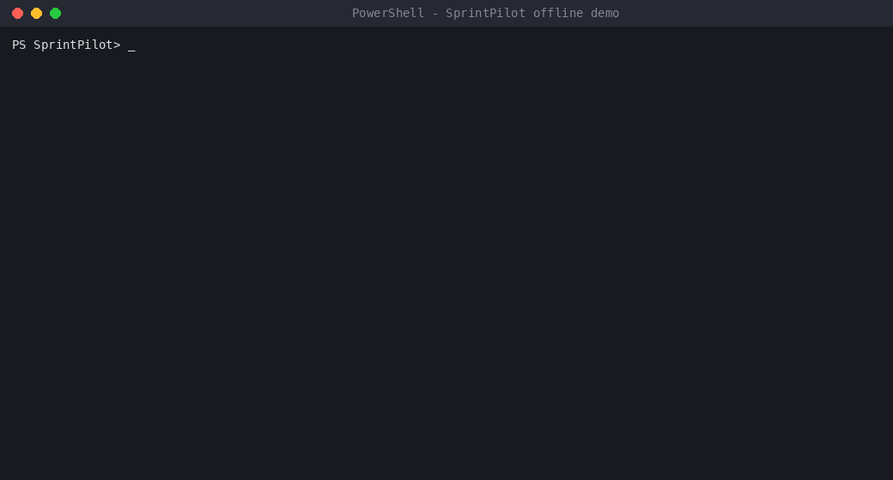
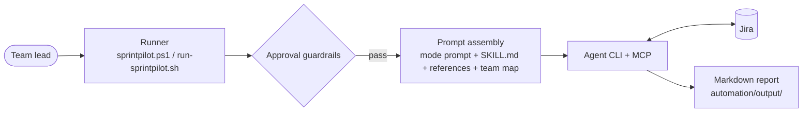

# SprintPilot

[](https://github.com/madhur0770/SprintPilot/actions/workflows/ci.yml)

**Approval-gated sprint planning and Agile reporting for Jira teams, driven from PowerShell.**

SprintPilot packages nine Agile workflows (scope shaping, backlog triage, owner recommendation, load balancing, health inspection, risk detection, progress pulse, stand-up brief, retrospective notes) as prompt templates plus a small, tested runner. The runner enforces dry-run defaults and an approval gate, then hands the assembled instructions to an MCP-capable agent CLI that reads Jira through an Atlassian/Jira MCP server you configure.

It is a local CLI and prompt-orchestration project. It is not a Jira server, a Jira SDK, an MCP server or a web application.

Project page: <https://madhur0770.github.io/SprintPilot/>



*Terminal replay of a real run of the offline demo (paths shortened).*

## Try it in under a minute (no Jira, no account)

```powershell
.\scripts\demo-sprintpilot.ps1
```

Works on Windows PowerShell 5.1 and PowerShell 7. It reads fictional data from [`examples/demo-sprint.yaml`](examples/demo-sprint.yaml) and writes `automation/output/offline-demo-report.md`. No network, credentials, Python, Jira or agent CLI are involved, and nothing is modified. The committed result is [`examples/sample-report.md`](examples/sample-report.md), and CI fails if the script's output ever drifts from it.

## What the live workflow does

| Mode | Purpose | Can change Jira with `-Apply` |
|---|---|:---:|
| `shape-sprint` | Propose sprint scope from the backlog | Yes |
| `triage-queue` | Classify backlog items and next actions | Yes |
| `suggest-owner` | Recommend assignees with confidence and risk | Yes |
| `balance-load` | Find overload and propose safe moves | Yes |
| `inspect-sprint` | Sprint health: blocked, stale, unassigned, overdue | No |
| `surface-risk` | Delivery threats only, with next actions | No |
| `progress-pulse` | Status snapshot with movement since last run | No |
| `standup-brief` | Daily team summary | No |
| `retro-notes` | Retrospective inputs from sprint patterns | No |

Details: [docs/workflows.md](docs/workflows.md).

## Architecture



Full description and safety model: [docs/architecture.md](docs/architecture.md).

## Safety by design

- **Dry-run by default.** Mutation needs an explicit `-Apply`; report-only modes reject it.
- **Approval gate.** Assignee-changing runs need `-ApprovedBy` matching a configured assigning authority, checked before the agent starts.
- **Audit log.** Apply runs append start and completion records to `automation/output/approvals.log`.
- **Private configuration.** The team map (`team-map.local.yaml`), generated reports and virtual environments are git-ignored.
- **Honest limits.** The approval check is a local string match, not an identity provider; Jira permissions come from your MCP credentials. See [docs/limitations.md](docs/limitations.md).

## Live Jira setup

Requirements: Windows 10/11 with PowerShell 5.1+ (Bash scripts are optional), Python 3 with PyYAML, Codex CLI (installed and authenticated) and an Atlassian/Jira MCP server configured for it. WSL is not required.

```powershell
.\scripts\setup.ps1                                   # local .venv + PyYAML
Copy-Item references\team-map.example.yaml references\team-map.local.yaml
# edit team-map.local.yaml with your board, project key, team and authorities
.\scripts\validate-sprintpilot.ps1
.\scripts\sprintpilot.ps1 -Mode standup-brief -ProjectKey YOUR_PROJECT_KEY
```

More examples (dry-run first):

```powershell
.\scripts\sprintpilot.ps1 -Mode shape-sprint -BoardId YOUR_BOARD_ID -ProjectKey YOUR_PROJECT_KEY
.\scripts\sprintpilot.ps1 -Mode inspect-sprint -SprintId YOUR_SPRINT_ID
.\scripts\sprintpilot.ps1 -Mode suggest-owner -IssueKeys DEMO-101,DEMO-102
```

Configuration reference: [docs/configuration.md](docs/configuration.md). Windows notes: [docs/windows-setup.md](docs/windows-setup.md). Live runs were verified read-only against a Jira Cloud test project; write access has not been exercised.

## Testing

```powershell
python -m pip install -r requirements.txt
python scripts/validate_sprintpilot.py
python -m unittest discover -s tests -v
```

The test suite covers the validator (missing prompts, credential-like values, placeholder emails, broken links, non-synthetic demo data) and the demo (output matches the committed sample, totals agree with the fixture, over-capacity detection, failure on missing or invalid fixtures, no network or agent calls). GitHub Actions runs everything on Windows PowerShell 5.1, PowerShell 7 and Linux, and syntax-checks the Bash scripts.

## Project structure

```text
scripts/       PowerShell runner, setup, offline demo, validator (+ Python validator)
automation/    Bash runner and wrappers, nine prompt templates
references/    Team-map example, JQL guide, ownership policy
examples/      Synthetic demo fixture and committed sample report
docs/          Architecture, workflows, configuration, setup, limitations, project page
tests/         Unit tests
```

## Limitations

- Analysis quality and any Jira actions depend on the model, MCP tools, Jira configuration and the team map.
- No GUI, analytics storage or built-in scheduler (use Windows Task Scheduler to call the PowerShell entry point).
- Live integration needs user-specific Jira and MCP setup; the offline demo does not exercise it.

## Future improvements

- Agent-CLI abstraction so the runner is not tied to a single CLI.
- Machine-readable (JSON) report output alongside Markdown.
- More synthetic fixtures covering each workflow offline.

## Author

Madhur Kumar Rana
