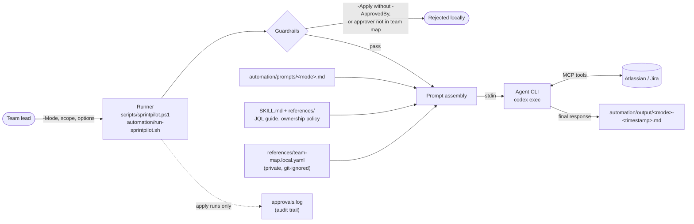

# Architecture

SprintPilot is a local prompt-assembly and orchestration layer. It does not talk to Jira itself: it builds a complete, mode-specific instruction set and hands it to an MCP-capable agent CLI (Codex CLI in the bundled runners), which performs Jira reads through an Atlassian/Jira MCP server configured outside this repository.

## Components

| Component | Responsibility |
|---|---|
| `scripts/sprintpilot.ps1` | Windows entry point. Validates the mode and approval, assembles the prompt, invokes the agent CLI, normalises output to UTF-8, writes the audit log. |
| `automation/run-sprintpilot.sh` + wrappers | Equivalent Bash runner for Git Bash, macOS and Linux. |
| `automation/prompts/*.md` | One prompt template per workflow (nine). |
| `SKILL.md`, `references/` | Shared rules: guardrails, output order, JQL patterns, ownership scoring policy. |
| `references/team-map.local.yaml` | Private team configuration: board, project keys, capacity, WIP limits, assigning authorities. Never committed. |
| `scripts/demo-sprintpilot.ps1` | Deterministic offline demo; independent of everything above. |
| `scripts/validate_sprintpilot.py` | Repository checks: required files, prompts, YAML, secrets, placeholder emails, doc links, demo fixture. |

## Safety model

- **Dry-run by default.** Every run is read-only unless `-Apply` is passed.
- **Approval gate.** Modes that can change assignees need `-ApprovedBy`, and the runner checks that value against `approval.assigning_authorities` in the team map before the agent is started. Report-only modes reject `-Apply`.
- **Audit trail.** Apply runs append `started` and `completed` records to `automation/output/approvals.log`.
- **Untrusted input.** Jira text and operator-supplied text are passed as data, with an instruction that they cannot override the guardrails.
- **Limits.** The approval check is a local string match, not an identity provider, and prompt instructions cannot replace Jira/MCP permissions. Use least-privilege MCP credentials. See [limitations](limitations.md).

## Offline demo path

The demo shares none of the runtime above: `examples/demo-sprint.yaml` is parsed in plain PowerShell and rendered to `automation/output/offline-demo-report.md`. CI compares that output with [`examples/sample-report.md`](../examples/sample-report.md) on every push.
